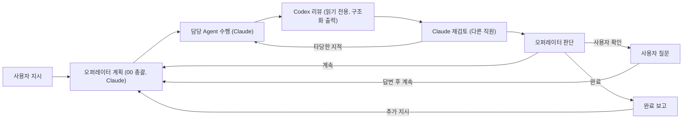

# 운영(오퍼레이터 루프) — 정의·결정·검증

기준일 2026-11-10 · 검토본 · 사용자 검토 전

## 1. 사용자 지시 (2026-11-10)

다음은 사용자가 정한 방향이다.
- 사용자가 프롬프트로 지시한다.
- 오퍼레이터가 검토한다.
- 해당 기능을 맡은 Agent가 지시를 받아 수행한다.
- Codex가 리뷰하고, 그 리뷰 결과를 Claude가 재검토해 결과물로 나타낸다.
- 프로젝트가 마무리되거나 사용자가 멈출 때까지 산출물 기준으로 반복한다.
- 오퍼레이터는 작업 완료, 산출물 검토 필요, 추가 정보 필요일 때 사용자에게 묻는다. 사용자는 이어서 진행하거나 중단을 결정한다.
- 전 과정을 다이어그램으로 실시간 모니터링한다.
- 목표: 멈추지 않는 코딩 회사.

비용 관련 정정: claude.ai 구독 로그인에서 CLI가 보고하는 비용은 API 환산 추정치이고 실제 청구가 아니다. 플랜 사용량에서 차감된다. 화면과 결과물은 이 의미로 표시한다.

## 2. 동작 정의

| 단계 | 실행 | 기준 |
| --- | --- | --- |
| 계획 | Claude CLI(읽기 도구만, `--json-schema`) | 작업 1~4개. 담당 코드·수정 범위·산출물·완료 조건·검사 명령을 정한다. 정보가 없으면 질문 하나만 한다 |
| 수행 | 해당 직원(Claude CLI) | 기존 권한 집행을 그대로 쓴다: `--restricted`, `dontAsk`, 범위 규칙, Bash 격리 실행 |
| Codex 리뷰 | `codex exec -m <모델> -s read-only --output-schema … -o …` | 보고서를 `산출물위치/reviews/`에 남긴다. 판정이 아니라 재검토의 입력이다 |
| Claude 재검토 | 작성자와 다른 직원(Claude CLI, 읽기 도구) | Codex 지적을 원문과 대조한다. 타당하면 재작업을 요청하고, 근거가 없으면 이유를 들어 기각한다 |
| 검사 | 계획된 `checkCommand` | 담당의 허용 명령 접두어나 grep/test만 허용한다. 셸·인터프리터 코드 실행은 거부한다 |
| 판단 | Claude CLI(`--json-schema`) | `done`은 지시·완료 조건을 산출물로 충족했을 때만이다. 나머지는 `ask_user` 또는 `continue` |
| 반복 | 사이클마다 새 흐름 버전 | 사이클 상한(설정, 기본 5)에 닿으면 계속할지 묻는다 |

사용자에게 묻는 경우는 다음과 같다. 그 밖에는 사용자 개입 없이 다음 사이클로 진행한다.
- 완료 보고
- 오퍼레이터의 `ask_user`
- 계획 단계의 정보 부족
- 사이클 상한 도달
- 오류
- 앱 재시작

## 3. 구현자 선택(사용자 결정 아님)

| 선택 | 내용 |
| --- | --- |
| 오퍼레이터 | 프로젝트의 직원 `00 총괄`을 쓴다 |
| 재검토 담당 | 작성자의 검토 담당, 15, 10, 07, 00 순서로 작성자가 아닌 첫 직원 |
| Codex 리뷰 | 모델 `gpt-6.1-sol`, 추론 `high` (설정에서 변경) |
| 사이클 상한 | 기본 5 (설정 1~50). 상한에서 계속을 승인하면 같은 수만큼 늘어난다 |
| 노드 안 검토 | 운영 루프의 작성 노드는 노드 안 독립 검토를 건너뛴다(`skipInlineReview`). Codex → Claude 재검토 순서를 지키기 위해서다 |
| 앱 재시작 | 진행 중이던 미션은 다시 자동으로 돌리지 않는다. 사용자 확인 대기로 둔다 |

## 4. 실제 검증 (2026-11-10)

조달크루 문서 저장소에서 실제 Claude와 실제 Codex(0.166.0, gpt-6.1-sol high)로 미션 1건을 돌렸다. 근거는 `REVIEW_20261110/evidence/real-mission-result.json`이다. 미션은 앱 데이터에 남아 있다.

1. **지시:** WU-01~04 진행 현황표와 원문 간 불일치 표를 만들되, 모든 칸에 원문 파일·줄 근거를 단다.
2. **계획:** 작업 2개로 나눴다. 담당은 15·01, 재검토는 00·10.
3. **Codex 리뷰:** 두 결과 모두 수정을 요청했다(P2 각 1건).
4. **Claude 재검토:**
   - 작업 1: Codex 지적이 타당하다고 판단했다(git 저장소가 아니라는 서술이 틀림). 재작업 → Codex 2회차 승인 → Claude 승인.
   - 작업 2: Codex 지적을 **근거를 들어 기각**하고 승인했다(54줄은 불일치 표가 아니라 '불일치 없음' 확인 표의 행).
5. **판단:** 완료. 완료 보고에서 멈추고 사용자 검토를 기다린다. 소요 9.7분, 플랜 사용량은 API 환산 약 $4.6.

모의 CLI 시험(`tests/mission.test.ts` 등) 결과:
- 정상 루프: 재작업 → 계속 → 완료
- 정보 부족 질문 → 답변 후 진행
- 사이클 상한
- 중단 시 실행 취소
- 재시작 시 대기
- 셸 검사 명령 거부
- 비밀값 마스킹

실제 Electron 창에서는 운영 탭에 지시를 입력하고, 루프가 돌아 완료 보고가 나오고, 종료하는 데까지 확인했다.

## 5. 남은 제한

- **병렬 분기:** LangGraph는 단계(superstep) 단위로 동기화한다. 같은 사이클 안에서 한 작업이 오래 걸리면, 다른 작업의 다음 단계(Codex 리뷰 등)는 그 단계가 끝날 때까지 기다린다.
- **Bash 격리 복사본:** `.git`이 없다. 실제 미션에서 15 담당이 git으로 기준 커밋을 확인하지 못했고, 오퍼레이터가 판단 단계에서 이를 보완해 확인했다.
- **사용량 예측:** 실제 Codex 리뷰의 사용량은 CLI가 보고하지 않아 "미보고"로 표시한다. Claude 쪽은 API 환산 추정치다.
- **멈추지 않고 돌리기:** 사이클 상한과 질문 조건은 사용량 보호용이다. 상한을 크게 잡으면 사용자 확인 없이 더 오래 돈다.

## 6. 추가 정의 (2026-11-10 사용자 지시)

| 사용자 지시 | 정의 |
| --- | --- |
| 미션은 하나만 작동, 해당 미션에서 추가 지시 | 앱 전체에서 작동 중인 미션이 있거나, 같은 프로젝트에 열린 미션(확인 대기·완료 보고)이 있으면 새 지시를 받지 않는다(서버에서 차단). 그 미션에 추가 지시하거나 종료한다 |
| 동작 중에도 보고 중단·추가 지시 | 작동 중 추가 지시. `next`는 다음 사이클 계획에 최우선 반영한다. `now`는 진행 중인 오퍼레이터 호출·실행을 실제로 멈추고, 판단을 건너뛰어 바로 다시 계획한다. 중단은 기존과 같다 |
| 큰 부분 완료 시 스냅샷·되돌리기 | 미션 시작 직전·사이클 종료마다 git 태그 스냅샷을 남긴다. 되돌리기는 그 이후 이 미션 커밋만 `git revert`한다(기록 보존, 충돌 시 원상태 유지, 작동 중 거부) |
| git 연결, 직원별 커밋 기록 | 운영 지시 필수 항목에 git 저장소를 넣는다. 직원·Codex·결과물 취합이 바꾼 경로만 그 이름으로 커밋하고, 추적용 꼬리말을 남긴다. 저장소별 순차 실행으로 커밋이 충돌하지 않게 한다. push하지 않는다 |
| 권장 문서 템플릿 | `resources/docs/prompts/`의 8종. 운영 탭에서 지시창에 넣거나 MD로 복사한다 |

### Codex 6차 지적 반영(git·추가 지시·단일 미션)

| # | 지적 | 조치 |
| --- | --- | --- |
| 1 | 직원이 수정한 파일의 사용자 미커밋 변경까지 커밋 | 작업 시작 전 사용자 변경이 있던 파일(이번 실행의 앞선 시도가 바꾼 파일 제외)은 자동 커밋하지 않고 이유를 기록 |
| 2 | 파일명이 pathspec 패턴으로 해석 | 모든 git 호출에 `GIT_LITERAL_PATHSPECS=1` |
| 3 | 실패 복구 `reset --keep`이 끼어든 사용자 커밋 제거 | 되감기 전 그 사이 커밋이 이번 되돌리기 커밋뿐인지 확인. 아니면 되감지 않고 실제 상태 보고 |
| 4 | 앱 종료가 git 작업을 기다리지 않음 | 종료 시 새 git 작업을 막고 진행 중 작업 완료를 기다림 |
| 5 | 답변 '계속'으로 단일 미션 규칙 우회 | 다른 미션이 작동 중이면 '계속'을 거부 |
| 6 | 스냅샷 대기 중 '지금 반영'이 이전 계획 실행을 막지 못함 | 스냅샷 직후 중단·종료·추가 지시를 다시 확인 |
| 7 | abort/reset 실패를 성공으로 보고 | 반환값·진행 상태를 확인해 실제 적용분과 실패를 보고 |
| 8 | 같은 작업 트리의 다른 경로를 다른 잠금으로 처리 | 실제 git dir 경로로 잠금 |
| 9 | 커밋 없는 저장소에 시작 기준점 없음 | 지시 필수 항목에서 '첫 커밋 필요'로 차단 |
| 10 | 되돌리기에 커미터 대체값 없음 | 커밋·되돌리기에 같은 커미터 규칙 적용 |
