# CREWGENAI 개발팀 관리 (Agent Workspace)

CREWGENAI 개발팀 관리는 사용자가 팀장이 되어 AI 직원(Agent) 팀을 꾸리고, 지시를 내려 일을 맡기는 데스크톱 앱이다. 오퍼레이터(00 총괄)가 지시를 작업으로 나눠 직원에게 배정하고, 결과는 Codex 리뷰와 다른 직원의 재검토를 거쳐 하나의 결과물로 모인다.

앱에는 AI 모델이 들어 있지 않다. 각 컴퓨터에 설치되어 로그인된 **Claude CLI**(작업)와 **Codex CLI**(교차 검토)를 실행한다.

## 업데이트 내역

날짜별 변경·검증 결과·확인하지 않은 것은 앱의 **사용법·검증 결과·업데이트 내역 → 업데이트 내역** 탭과 [CHANGELOG.md](CHANGELOG.md)에 있다(같은 내용).

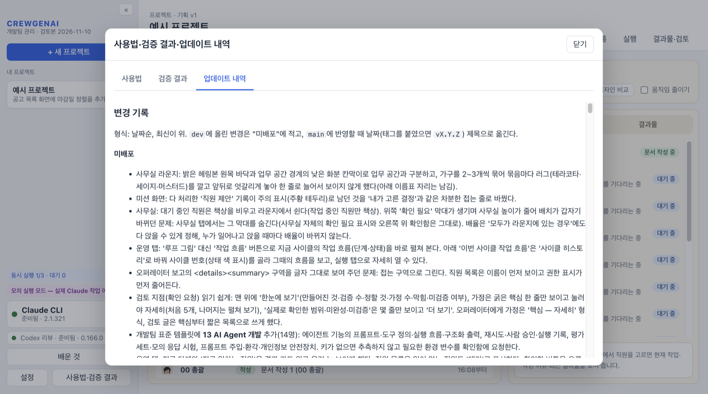

## 한눈에 보기

- **지시와 결과 검토만 하면 된다**: 오퍼레이터가 계획하고, 역할별 직원(기본 16명, 모델은 자리에 맞춰 Fable 5.2·Opus 5.5·Sonnet 5.5)이 스킬을 써서 작업하며, Codex 리뷰와 다른 직원의 재검토를 거친다.
- **사람에게 묻는 것은 확인함 하나로**: 제품 결정·결과 검토·main 병합·API 키 같은 정보 요청만 온다. 명령 허용·경로 읽기 같은 기술 권한은 먼저 오퍼레이터가 허용된 방법으로 다시 계획하고, 그래도 꼭 필요한 명령(오퍼레이터가 요청하거나 같은 막힘이 두 사이클 넘게 반복)만 확인함 팝업으로 허용을 묻는다(미션은 멈추지 않음).
- **멈추지 않고 이어 간다**: 앱 재시작·Claude 한도·일시 장애 뒤에 자동으로 이어 가고, Max 요금제 주간 한도를 초기화까지 나눠 쓴다.
- **git은 알아서**: 매일 비밀값을 뺀 변경을 dev에 커밋·push하고, 큰 단원이 끝나면 main 병합을 묻는다.
- **참고 자료**: 지시에 파일을 첨부하거나(붙여넣기 포함) 참고 사이트를 말하면 화면을 저장해 직원이 읽게 한다.
- **휴대폰**: 텔레그램으로 진행 확인·결정·추가 지시.

## 작동 흐름

지시 하나가 계획 → 직원 작업 → 리뷰·재검토 → 검사 → 판단을 거쳐 결과물이 된다. 작업은 서로 기다리지 않는다: 먼저 끝난 직원의 결과부터 바로 Codex 리뷰로 넘어간다. 에이전트가 스스로 풀 수 없는 업무는 같은 설정으로 다시 돌지 않고 **확인 필요**로 보류해 사용자에게 먼저 보이고, 나머지 작업은 계속한다. 미션이 끝나면 대화에서 배운 것을 정리해 다음 지시에 반영한다.

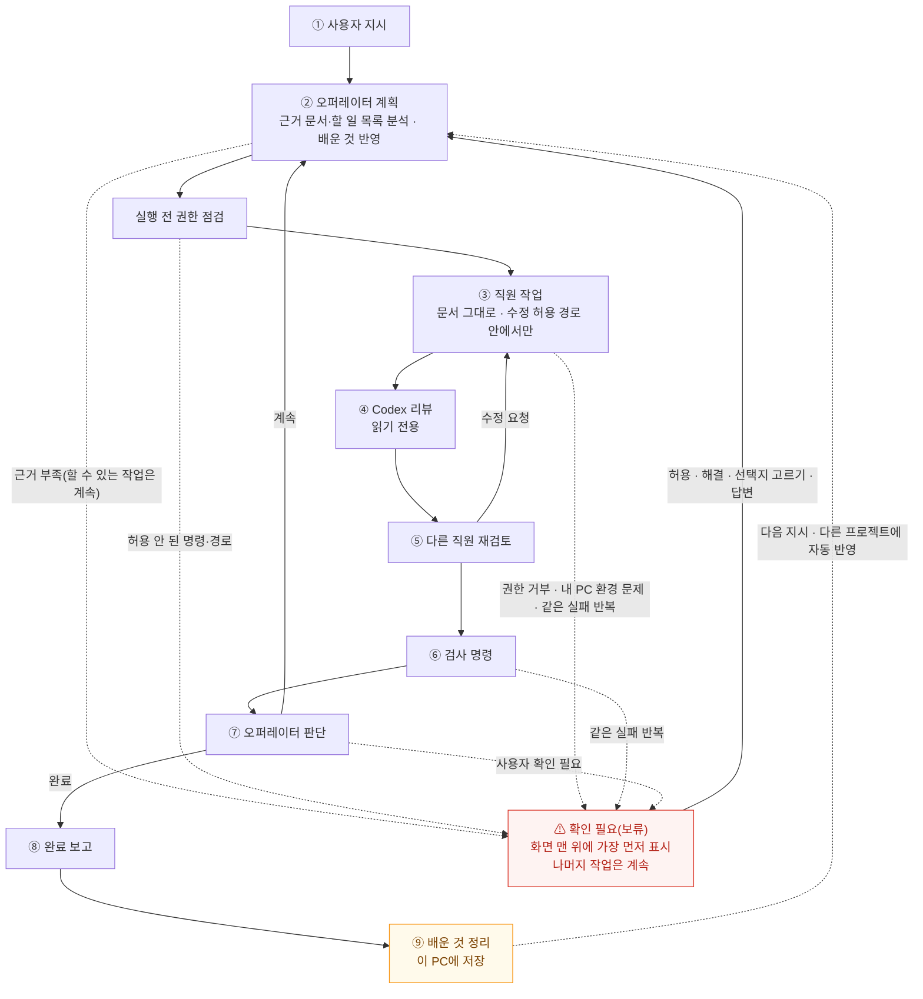

### 데이터가 머무는 곳

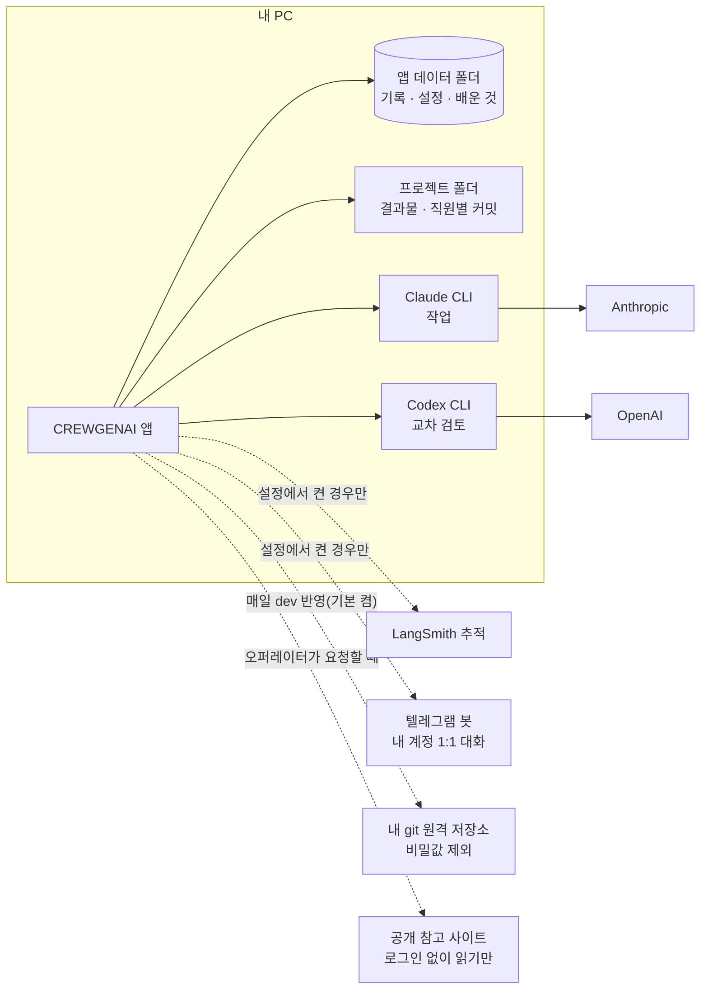

앱이 직접 밖과 주고받는 것은 LangSmith 추적(기본 꺼짐), 텔레그램 알림·응답(기본 꺼짐), 매일 dev 반영 때 내 git 원격 저장소로의 push(비밀값 제외, 설정에서 끌 수 있음), 오퍼레이터가 요청한 공개 참고 사이트 읽기(로그인·쿠키 없는 새 세션, 이 PC·사설망 주소 차단)다. 작업 내용은 사용자가 로그인한 CLI가 각 서비스로 보낸다. 자세한 내용: [SECURITY.md](SECURITY.md)

## 흐름별 화면

화면은 시험용 모의 실행으로 만든 예시 프로젝트다(경로는 예시 경로로 바꿔 표시). macOS판 화면이며, Windows판은 같은 구성에 Windows 표기(탐색기, Ctrl+Enter)를 쓴다.

### 1. 기획 — 무엇을, 어느 폴더에서, 어디까지

목표·완료 조건·작업 범위와 연결 폴더(저장소 하나 또는 여러 저장소를 담은 상위 폴더), 직원이 고칠 수 있는 경로를 정한다. **완성 문서 목록**의 프롬프트로 근거 문서를 만들어 올린다.

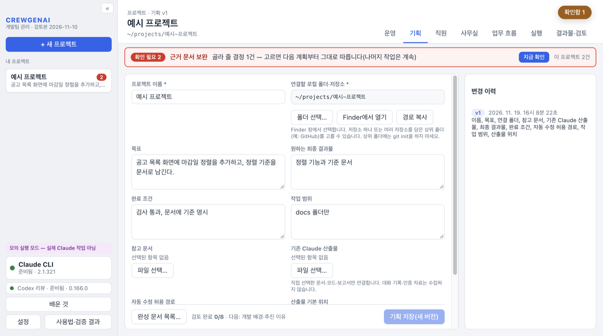

### 2. 직원 — 팀 구성

기본 템플릿(소프트웨어 개발팀 표준 16명, 범용 소규모 팀 10명. 두 세트 모두 진척 관리 PM·문의 응대 HD 직원 포함)으로 시작해 역할·업무지시·도구·허용 명령·검토 담당을 정한다. 휴가(비활성)·해고(삭제)할 수 있다.

**업무지시와 모델**: 템플릿 직원의 업무지시는 역할·목적(왜 이 자리가 있는가)·맡는 일·좋은 결과·하지 않는 일·맞는 스킬과 공통 규칙으로 되어 있다. 모델은 자리에 맞춰 나눈다 — 가장 똑똑한 Fable 5.2는 사용량이 많아 설계 자리에만, 자주 불리는 총괄·구현·리뷰·보안 검토·데이터 수집은 Opus 5.5, 문서·시험 실행·통합 정리는 Sonnet 5.5. Fable 5.2는 Opus 5.5보다 사용량을 약 2배 쓴다. 직원 설정에서 언제든 바꿀 수 있다.

**스킬 사용**: 직원 도구에서 **Skill**을 켠 직원은 이 PC에 설치된 스킬을 쓴다. 어느 폴더의 스킬을 쓸지는 **설정 > 스킬 폴더**에서 정한다(기본은 `~/.claude/skills`, `~/.agents/skills`, Claude 데스크톱 앱이 계정 스킬·플러그인을 동기화해 둔 `~/.claude/skills/synced/…`·`~/.claude/plugins/synced/…` 중 스킬이 있는 것. 폴더마다 찾은 스킬 이름을 보여 줌). 직원은 개인 설정을 읽지 않는 제한 모드로 실행되므로, 앱이 실행할 때마다 스킬 파일만 이 사용자 전용 앱 폴더에 읽기 전용 사본으로 만들어 넘긴다. 보호 장치:
- 플러그인의 훅·MCP 서버·명령은 가져오지 않고, 직원 실행에서는 훅과 스킬의 셸 미리 실행(`` !`명령` ``)을 끈다.
- SKILL.md 머리말은 이름·설명 등만 남기고 `allowed-tools`·`hooks`·`model` 같은 권한·실행을 바꾸는 항목은 뺀다. 스킬을 써도 수정 폴더·Bash 허용 명령·웹 권한은 직원 설정 그대로다.
- 비밀 파일(.env, 키 파일)·링크·다른 사용자가 바꿀 수 있는 폴더의 스킬은 옮기지 않는다.
- 검토 담당·오퍼레이터는 스킬을 쓰지 않는다. 직원 제안으로 새로 만든 직원도 Skill 없이 시작한다(자동 처리가 켜져 있으면 실행할 때 파일 쓰는 직원에게 Skill이 더해진다).

**자동 처리**(설정 > 자동 처리, 기본 켬): 사람이 손댈 곳을 PR 병합과 방향 결정으로 줄인다.
- **작업 브랜치**: 저장소가 `dev`·`main`·`master`·`develop`에 있으면 직원 변경을 거기에 커밋하지 않고 `feat/crewgenai-<미션 앞 8자리>` 브랜치를 만들어 커밋한다. 사용자의 미커밋 변경은 커밋하지 않고 작업 트리에 그대로 따라간다. 사용자가 dev로 돌아갔을 때 병합 안 된 작업 브랜치가 있으면 섞지 않고 `-2`처럼 번호 붙은 브랜치를 새로 만든다. push·PR·병합은 하지 않는다.
- **진행 보고**: 오퍼레이터가 사이클마다 판단할 때 운영 화면 맨 위의 '진행 보고'를 이 순서로 쓴다 — 한 줄 요약, 항목별 상태 표(계획 / 코드 작성 / 시험 통과는 직접 실행해 본 것만 / PR 필요 / 막힘), 진척 수, 사람이 할 일(PR 병합, 제품 결정 3개 이하), 다음 사이클 할 것, 기록. 확인 필요에는 사용자만 정할 수 있는 결정(제품 동작·범위·우선순위·병합·비용·공개)만 올리고, 자료끼리의 작은 불일치는 근거가 더 분명한 쪽을 따른 뒤 기록에 남긴다.
- **시험 명령**: Bash를 가진 직원은 저장소에 실제로 있는 `scripts/gradle.sh`, `scripts/check.sh`, `package.json`의 `check`(있으면 `scripts/npm.sh run check`)를 허용 없이 실행한다. 격리 복사본에서 네트워크 없이 돌며, 내려받아 둔 의존성(`.venv`, 상위 폴더의 숨김 도구 폴더)은 읽기용으로 링크하고, Gradle 캐시(`.gradle`)와 npm 저장소의 `node_modules`는 macOS 즉시 복제로 실행마다 복사해 써서 실제 캐시는 바뀌지 않는다. 격리 밖 쓰기는 실행별 임시 폴더만 더 허용하고, 비밀 성격의 환경 변수는 직원 실행에서 빼고, Claude 인증 변수도 격리된 명령에서는 지운다. Gradle·Spring 시험은 로컬 소켓이 필요해 **설정 > 자동 처리 > 시험 명령에 로컬 소켓 허용**을 켜야 돈다(기본 끔. 켜면 격리된 시험도 이 PC의 localhost 서비스에 접속할 수 있다). 시험이 만든 `build/`·`.next/` 등 git이 무시하는 파일은 반영하지 않는다.
- **스킬**: 연결 폴더(와 그 아래 저장소)의 `skills/`·`.claude/skills/`를 스킬 폴더에 자동으로 더한다. 링크로 저장소 밖을 가리키는 스킬은 받지 않는다.
- **문서 저장소 최신화**: 사이클 시작 때 빌드 파일이 없는 저장소 중 프로젝트의 참고 문서·이전 결과물·수정 허용 경로가 가리키는(또는 스킬을 가져오는) 저장소만, `dev`·`main` 등에 있고 추적 브랜치가 있을 때 받아 와서 fast-forward한다. 사용자 변경(git이 무시하는 로컬 파일 포함)과 겹치거나 앞선 로컬 커밋이 있으면 그대로 둔다. 연결 폴더 전체 같은 상위 경로는 대상을 정하는 근거로 보지 않는다.

| 기본 템플릿 불러오기 | 직원 정의 |
|---|---|
| 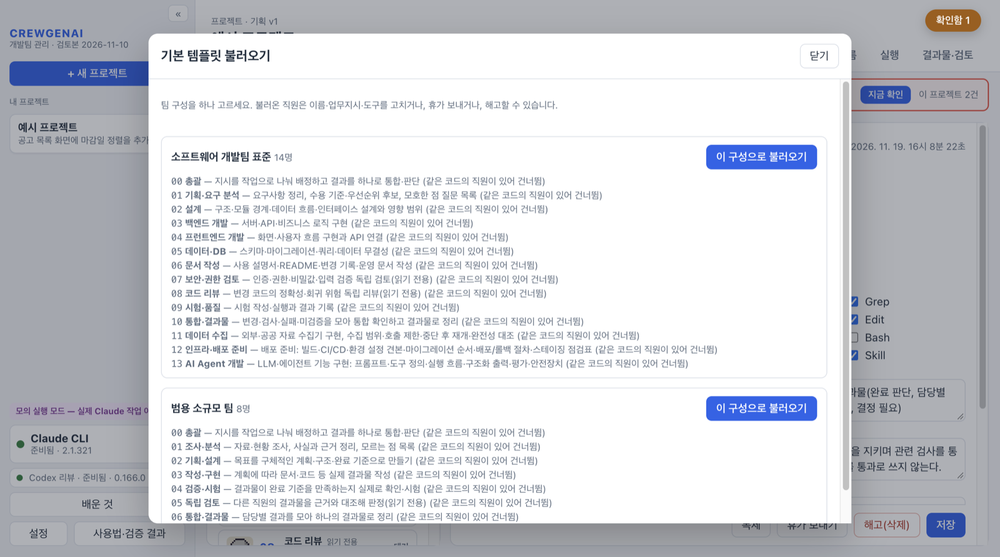 | 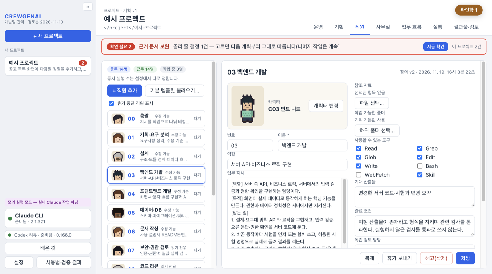 |

### 3. 업무 흐름 — 단계를 이어 그리기

직원 작업·명령 기반 검사·독립 교차검토·Codex 리뷰·조건 분기·결과물 취합·사용자 검토를 카드로 놓고 연결선으로 순서를 정한다. 연결선 종류(다음·실패 시 재작업·조건 참/거짓)가 실제 실행 순서가 된다. 운영 탭의 미션은 오퍼레이터가 이 흐름을 사이클마다 자동으로 짠다.

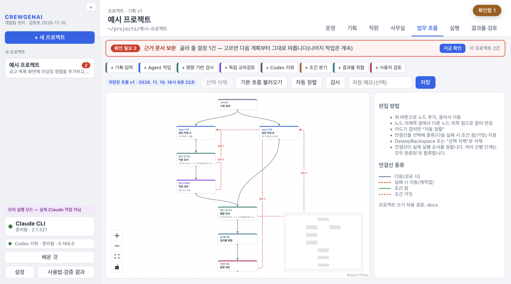

### 4. 운영 — 지시하면 팀이 계속 일한다 (흐름 ①~⑧)

아래 고정 입력창에 지시한다. 진행 중에는 추가 지시·지금 반영·중단을 쓴다. 맨 위에 지금 단계와 **지금 일하는 직원**이 늘 보이고, '작업 흐름'으로 이번 사이클 흐름을 펼친다. 아래 **사이클 히스토리**에서 사이클 번호를 골라 그때의 흐름을 본다.

- **파일 첨부**: 입력창의 📎로 고르거나, 복사한 이미지(스크린샷)·파일을 입력창에 붙여 넣는다. 앱 데이터 폴더로 복사돼 오퍼레이터·직원이 읽기 전용으로 받는다(비밀값 파일·20MB 넘는 파일은 받지 않음).
- **참고 사이트**: "○○ 사이트를 참고해서"처럼 지시하면 앱이 그 공개 페이지를 로그인 없는 새 창으로 열어 화면 사진·본문·링크를 저장하고, 직원은 저장본만 읽는다(직원은 인터넷에 접속하지 않음).
- **검토 지점**: 큰 결과가 준비되면 '한눈에 보기'(만들어진 것·정할 것·가정·미검증·진척)와 굵은 핵심만 보이는 가정 목록, 눌러 볼 순서로 보고한다.
- **대기 중인 추가 지시**: 진행 중에 보낸 추가 지시는 오퍼레이터가 다음 계획에서 읽기 전까지 운영 화면 위쪽 '대기 중인 추가 지시'에 모여 보이고, **취소**할 수 있다. 취소한 지시는 기록에 남지만 계획·배운 것에는 쓰이지 않는다. 계획에 들어간 뒤에는 취소할 수 없으니 새 추가 지시로 바로잡는다.
- **문서 정리**(설정에서 끌 수 있음, 기본 켬): 계획 규칙상 직원은 보고·시연 문서를 사이클마다 새로 만들지 않고 주제별 문서 하나를 고친다. 화면 사진은 폴더 하나에 덮어쓴다.
  - 앱이 만든 실행 결과(`RESULT-…md`)와 Codex 리뷰 파일은 최근 실행 5개만 파일로 남긴다. 내용은 앱 기록에 그대로 있다.
  - 이미 쌓인 사이클별 문서(docs 폴더나 산출물 폴더 안의 `C100_FRONT.md`, `DEMO_C10_…md`, `c98-screens/` 같은 것)는 10사이클마다 정리한다. 문서 담당이 폴더별 `HISTORY.md`로 요약하고, 요약이 써진 폴더에서 git에 커밋돼 있고 바뀌지 않은 원본만 앱이 지운다. git 기록으로 되살릴 수 있다.
  - 커밋되지 않은 파일, 최근 3사이클 문서, 하루 안에 바뀐 문서는 지우지 않는다. 한 번에 4개 폴더·폴더당 40개까지 정리하고, 남으면 3사이클 뒤 이어서 한다.
- **기록이 많을 때**: 진행 기록은 최근 150건만 보여 주고 '이전 기록 더 보기'로 더 불러온다. 결과물 파일은 100개씩 보인다. 직원이 일하는 동안 화면은 1.5초 간격으로 묶어 새로 고친다.

#### 문의 — 개발을 멈추지 않고 물어보기

오른쪽 아래 **💬 문의**를 누르면 대화창이 열린다. **문의 응대(HD) 직원**에게 "지금 무엇을 하고 있어?", "그 파일은 어디 있어?", "왜 그렇게 정했어?"처럼 바로 물어볼 수 있다.

- 답은 지금 미션의 지시·진행 보고·작업 목록·최근 기록과 연결 폴더의 파일을 읽고 만든다(읽기 전용). 확인한 사실과 추측을 나눠 쓰고, 근거 위치를 알려 준다.
- 대화는 미션 지시로 전달되지 않는다. 질문이 개발 방향을 바꾸는 요청이면 직원이 **추가 지시 제안**을 함께 낸다. **추가 지시로 보내기**를 눌러야 대기 중인 추가 지시로 들어간다.
- 대화는 프로젝트별로 이 PC의 앱 데이터에만 저장되고, '지우기'로 지울 수 있다. 답할 때 Claude 사용량을 조금 쓴다(Sonnet 5.5). 직원이 없던 프로젝트에서는 처음 물을 때 한 번 채용되고, 휴가 중이면 답하지 않는다.

#### 진척 — 미션이 어디까지 왔는지

**진척 관리(PM) 직원**이 미션을 단원(사용자가 확인할 수 있는 기능 묶음) 5~15개로 나누고, 단원마다 완료 기준을 정한다. 이 목록은 첫 사이클 판단 뒤에 만들어지고, 그 뒤 사이클마다 단원 상태(시작 전·진행·검증 중·완료·막힘)와 확인 근거가 갱신된다. 개발은 목록을 기다리지 않고 바로 시작한다.

- **진척 메뉴**: 완료 비율, 상태별 개수, 단원 표(완료 기준·근거·메모), 뺀 단원, 계획 변경 기록을 보여 준다. 처음 만든 목록과 이후의 단원 추가·제외·완료 기준 변경은 **확인함**을 누를 때까지 '확인하지 않음'으로 표시되고, 검토 카드에도 '진척 N/M · 계획 확인'으로 나타난다.
- **완료 판단**: 단원은 확인 근거(시험 명령과 결과 수, 결과 파일, 화면 확인 기록)가 있어야 완료가 된다. 근거가 없으면 '검증 중'으로 둔다. 비율은 완료한 단원 수로만 세며, 시간 추정이 아니다.
- **미션 완료**: 모든 단원이 완료되면 미션이 완료 검토로 멈춘다. 남은 단원이 있으면 오퍼레이터가 완료라고 판단해도 계속 진행한다.
- **추가 지시·변경**: 운영 입력창으로 지시하면 진척 관리 직원이 단원을 더하거나 고치거나 뺀다. 어느 지시 때문인지 이유를 함께 남긴다. 이유 없이 빼거나 완료한 단원을 빼는 갱신은 앱이 받지 않는다.
- 진척 관리 직원은 파일을 고치지 않으며(읽기 전용), 작업 배정이나 검토도 맡지 않는다. 직원이 없던 기존 프로젝트에서는 첫 미션 판단 때 한 번 채용된다. 휴가 중이거나 해고된 상태면 목록을 갱신하지 않고, 이전처럼 오퍼레이터 판단으로 완료한다.

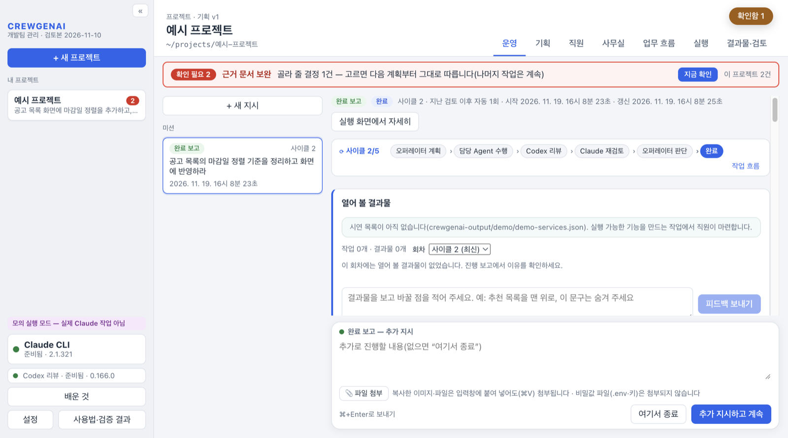

### 5. 실행 — 단계별 진행 상황

흐름이 실행되면 단계마다 상태(완료·검토 대기·재작업·실패)와 시도 횟수가 그림에 표시된다. 단계를 누르면 직원 출력·검사 결과·변경 파일을 보고, 선택 단계부터 다시 실행하거나 결과물·검토로 넘어간다.

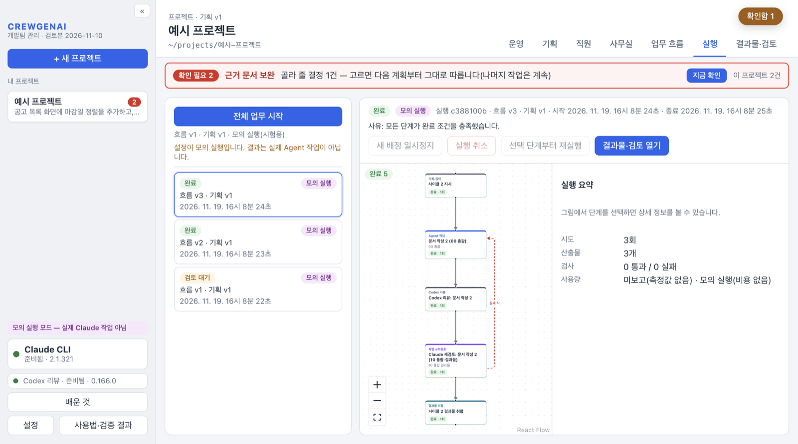

### 6. 사무실 — 지금 누가 무엇을 하는지 (흐름 ③~⑤)

직원 상태를 도트 그림 지도로 본다. 작업 중인 직원은 자기 책상에, 리뷰는 리뷰룸 탁자에(리뷰받는 직원과 검토자·Codex), 대기·휴식 중인 직원은 라운지의 소파·의자·빈백에, 휴가는 해변에 있다.

| 작업 중(나머지는 라운지) | 예시 상태로 본 전체 사무실 |
|---|---|
| 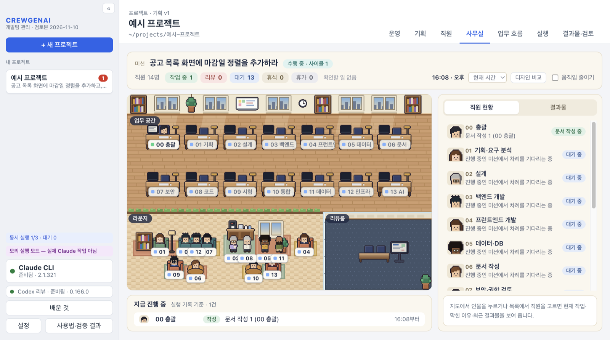 | 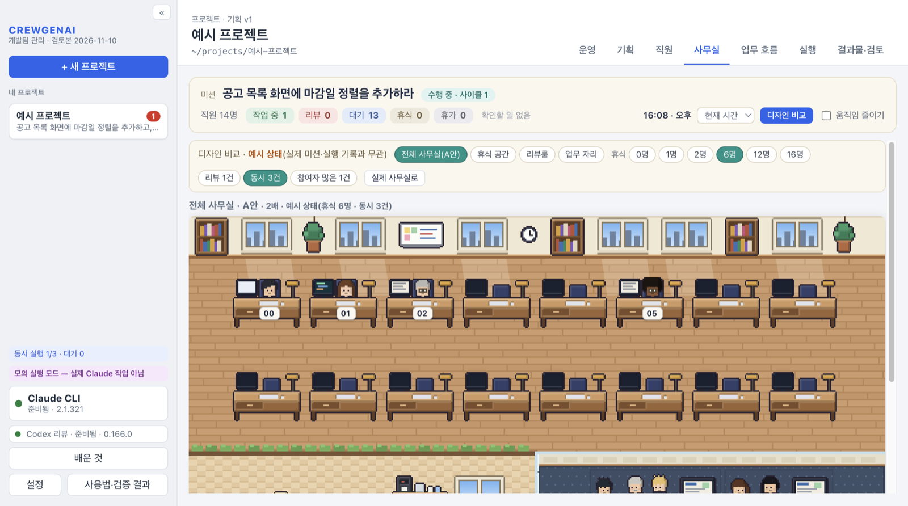 |

### 7. 확인 필요 — 에이전트가 풀 수 없을 때 (⚠)

내 PC 환경 문제(명령·프로그램 없음, 접근 거부, 네트워크·로그인)나 같은 실패 반복이 난 업무는 **보류**한다. 명령 허용·경로 읽기 같은 기술 권한 막힘은 기본으로 바로 묻지 않고 오퍼레이터가 허용된 방법으로 다시 계획한다. 그래도 꼭 필요하면(오퍼레이터 요청·같은 막힘 반복) 확인함 팝업에 **권한 요청**으로 올라와 그 직원에게만 허용할 수 있다. 셸 전체·sudo 같은 넓은 명령은 묻지 않는다(설정 > 기술 권한 요청에서 끄면 예전처럼 처음부터 묻는다). 보류한 업무는 해결하기 전까지 다시 계획하지 않고, 나머지 작업은 계속한다. 보류한 업무가 다시 막히거나 남은 일이 그것뿐이면 미션을 멈춘다. 실행 전에도 작업에 필요한 명령·폴더 밖 경로가 허용돼 있는지 점검해, 허용되지 않은 작업은 돌리지 않고 바로 확인 필요로 올린다. 화면 맨 위 빨간 막대·프로젝트 목록 숫자·미션 목록 맨 위로 가장 먼저 알린다. 권한은 화면에서 바로 허용(허용 명령·참고 문서)한 뒤 **해결했으니 다시 시도하게 하기**를 누른다.

불분명한 기준·허용 여부·유지 또는 되돌림처럼 **사용자가 고르면 되는 항목**은 오퍼레이터가 선택지(2~4개)를 함께 낸다. 항목마다 선택지를 고르거나, 직접 적거나, 나중에(보류)로 두고 **고른 대로 계속 진행**(멈춘 미션) 또는 **고른 결정 반영**(진행 중 미션)을 누른다. 고른 결정은 그 미션의 '사용자 결정'으로 남아 다음 계획부터 오퍼레이터·직원이 추측 없이 그대로 따르고, 같은 항목을 다시 묻지 않는다. 오퍼레이터 질문도 선택형이면 선택지 버튼으로 바로 답할 수 있다. 항목마다 **쉽게 말하면** 설명(무엇이 다른지·왜 막히는지·고르면 무엇이 달라지는지)과 **근거 위치**(파일·줄)가 붙고, 근거 위치를 누르면 해당 줄 앞뒤를 앱 안에서 바로 보거나 기본 앱으로 열 수 있다(읽기 전용, 비밀값은 가림).

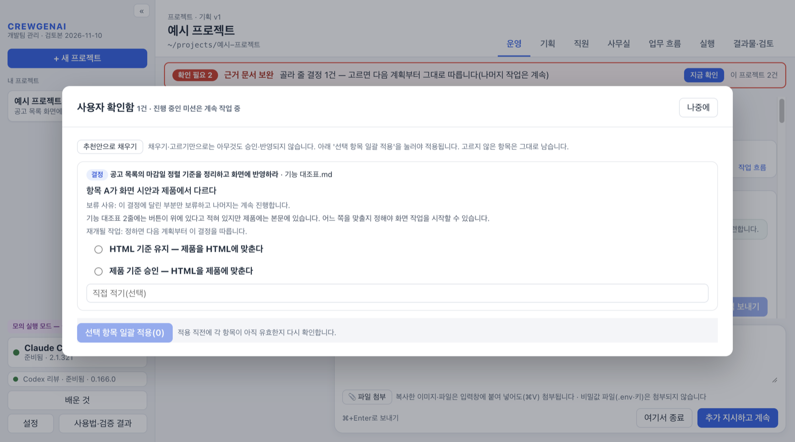

사이클을 돌다 지금 직원으로는 부족하다고 보이면(맞는 역할이 없음, 같은 직원이 역할·지시 때문에 반복해 엇나감, 직원 지시가 근거 문서·사용자 결정과 어긋남) 오퍼레이터가 **직원 제안**을 낸다. 새 직원(포지션) 추가나 기존 직원의 역할·지시 변경을 '왜 필요한가'와 지금·제안 비교로 보여 주고, **그대로 적용**·**고쳐서 적용**·**무시** 중에서 고른다. 진행은 계속된다. 제안으로는 도구·명령 권한이 바뀌지 않고(새 직원은 명령 권한 없이 시작), 오퍼레이터(00)는 바꾸지 않으며, 무시한 제안은 다시 내지 않는다.

### 8. 배운 것 — 다음 지시가 더 잘 맞도록 (흐름 ⑨)

미션을 끝내거나 종료하면 지시·추가 지시·답변·권한 허용에서 배운 선호·환경·규칙·사실을 이 PC에 저장하고 다음 지시와 다른 프로젝트에 자동 반영한다. 새로 배운 것은 **검토 필요**로 맨 위에 보이며, 맞음·고치기·끄기·지우기를 할 수 있다.

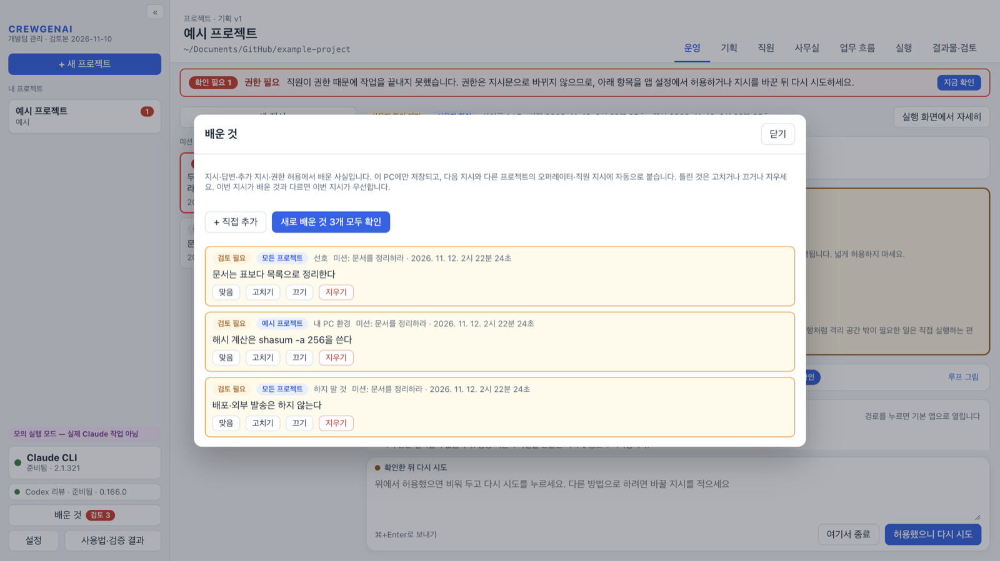

### 9. 확인함 — 자리를 비워도 개발은 계속

미션은 경과 시간이나 사이클 수만으로 멈추지 않는다. 사람이 정할 일은 진행을 막지 않고 **확인함**에 모인다.

- **확인함**: 결정·권한 허용·커밋 승인·결과 검토를 한곳에 요약해 보여 준다(관련 미션, 정할 것, 선택지·추천과 이유, 허용 범위, 적용하면 재개될 작업). **추천안으로 채우기**는 선택만 채운다. **선택 항목 일괄 적용**을 눌러야 반영되고, 적용 직전에 질문·선택지가 그대로인지 다시 확인한다. 고르지 않은 항목은 남는다. API 키·접속 정보가 필요한 결정은 확인함에서 값을 입력하고 **파일에 저장**을 누르면 앱이 프로젝트의 `.env` 파일(커밋 제외 확인, 이 PC에만)에 넣고 '넣었음'으로 처리한다. 값은 미션 기록·텔레그램에 남지 않는다. 새 확인 항목이 생기면 바로 팝업으로 떠서 고를 수 있다('나중에'로 닫은 항목으로는 다시 띄우지 않음). 연 동안 텔레그램 등 다른 곳에서 처리되면 그렇게 알려 주고, 정할 항목이 더 없으면 5초 뒤 저절로 닫힌다. 상단 **지금 확인**은 화면을 옮기지 않고 팝업으로 연다.
- **검토 지점**: 큰 결과가 준비되면 이번 기능·시연 열기·눌러 볼 순서·실제 확인 범위·가정한 세부·정할 것을 한 카드로 올리고 개발은 계속한다. 결정·피드백은 다음 계획부터 반영된다.
- **사용량 속도 조절**(설정, 기본 켬): Claude CLI가 호출마다 알려 주는 실제 주간·5시간 사용률로, 주간 한도를 초기화 시각까지 나눠 쓴다. 주간 창에서 지난 시간 비율만큼만 쓰고(주 초반 5%는 바로), 앞서 있으면 새 사이클 시작을 미룬다. 5시간 사용률이 90% 이상이면 그 창이 풀릴 때까지 쉰다. 사용률은 계정 전체 값이라 직접 쓰는 몫(기본 10%)은 남긴다. 진행 중인 단계는 끊지 않는다.
- **Claude 한도**: 해제 시각을 알면 그 시각에, 모르면 1시간 뒤 한 번 다시 확인해 자동으로 이어 간다. 대기 중에는 Claude를 부르지 않고, 결제·계정 변경도 하지 않는다. 미션 화면에 대기 사유·해제 시각·다음 확인을 보여 준다.
- **재시작**: 앱을 다시 켜면 멈춘 지점부터 자동으로 이어 간다(완료된 단계는 다시 실행하지 않음). 사용자가 중지한 미션은 다시 돌지 않는다. **일시정지**는 진행 중인 단계만 마치고 멈춘다.
- **실행 준비 확인**: 직원에게 일을 주기 전에 실제 직원 실행 환경에서 파일 쓰기·프로젝트 읽기·로컬 포트·Node·Java·npm을 확인한다.
- **시연**: 설정한 시연 서비스는 서비스별 **켜기**(처음이면 실행 명령을 보고 **승인하고 켜기**)로 띄운다. 오퍼레이터는 판단 직전에 승인된 서비스만 켜서 실제 응답을 근거로 쓴다.

### 10. git 반영 — 매일 dev, 큰 단원 끝나면 main

- **매일 dev 반영**(설정, 기본 켬, 22시): 프로젝트의 허용 경로에 든 저장소마다 미커밋 변경을 묻지 않고 커밋해 dev에 합치고 push한다. dev가 없으면 지금 브랜치에서 만든다. 앱 작업 브랜치에서 일했으면 dev에 합친다(갈라졌으면 임시 폴더에서 병합, 작업 트리는 그대로). 사용자 브랜치·충돌은 건너뛰고 이유를 보여 준다. **비밀값**은 .gitignore 규칙과 이름·내용 검사로 빼고 목록으로 보여 준다.
- **main 병합**: 큰 단원(마일스톤)이 끝났다고 오퍼레이터가 판단하면 확인함·텔레그램에 'main에 병합 / 아직 아님'을 묻는다. 승인하면 저장소마다 dev를 main에 합쳐 push한다.

### 11. 사용량 — Max 요금제를 한 주 동안

Claude CLI가 알려 주는 실제 주간·5시간 사용률을 보고, 주간 한도를 초기화 시각까지 나눠 쓰도록 새 사이클 시작을 미룬다(직접 쓸 몫 기본 10%는 남김). 5시간 사용률이 90%를 넘으면 그 창이 풀릴 때까지 쉰다. 진행 중인 단계는 끊지 않는다.

### 12. 텔레그램 — 휴대폰에서 확인·결정 (선택)

**설정 > 텔레그램**에서 켠다. 앱이 이 컴퓨터에서 텔레그램에 직접 묻는 방식(롱 폴링)이라 별도 서버·공개 포트가 필요 없다.

1. 텔레그램 @BotFather에서 `/newbot`으로 봇을 만들고 받은 토큰을 앱 설정 칸에 직접 붙여 넣는다(채팅·문서에 붙여 넣지 않는다). 토큰은 운영체제 보안 저장소(macOS 키체인 / Windows DPAPI)로 암호화해 이 PC에만 저장하고, 화면에는 다시 보여 주지 않는다. 보안 저장소를 쓸 수 없으면 저장하지 않는다.
2. **연결 코드 만들기** → 휴대폰에서 링크를 열고 시작 → 앱에 나타난 계정을 **이 계정 연결**로 확인한다. 처음 메시지를 보낸 사람을 자동으로 등록하지 않고, 등록한 계정과 봇의 1:1 대화에서만 조작할 수 있다.
3. 알림 받을 프로젝트·종류·묶음 시간과, 프로젝트별로 커밋 코드 차이·시연 화면 미리보기를 보낼지 정한다.

휴대폰에서 할 수 있는 것: `/menu` `/status` `/tasks` `/pending`(결정 고르기 → 적용) `/commits`(변경 상세·승인·수정 요청·보류·거절) `/results` `/usage` `/health` `/next`·`/now`(추가 지시) `/pause` `/resume` `/stop`. 일반 문장은 대상이 분명하면 다음 지시로 접수한다.

- 앱 확인함과 같은 처리를 쓴다. 한쪽에서 처리하면 다른 쪽 버튼은 실행되지 않고, 텔레그램 메시지의 버튼은 30초 안에 '✓ 처리됨'으로 바뀐다. 메시지 본문은 기록으로 남는다.
- 추천 표시·미응답·읽음·시간 경과는 승인이 아니다. 커밋 승인은 그 커밋만 만들고 push·병합·배포는 하지 않는다. 운영체제 명령은 실행하지 않는다.
- 앱을 완전히 종료하거나 컴퓨터가 꺼져 있으면 처리하지 못한다. 다시 켜지면 10분 넘게 지난 상태 변경 명령과 그동안 누른 버튼은 실행하지 않고 다시 확인하게 한다.
- 결과물의 '이 컴퓨터에서 여는 주소'는 그 컴퓨터에서만 열린다. 휴대폰에서는 허용한 시연 화면의 미리보기 사진으로 확인한다.

## 폴더 구성

| 폴더 | 내용 | 설치 파일 |
|---|---|---|
| [`mac/`](mac/) | macOS판(Apple Silicon). 기준 프로그램 | `.dmg` |
| [`windows/`](windows/) | Windows판(x64). macOS판과 같은 기능에 Windows 실행 방식만 바꾼 것 | 설치 프로그램 `-setup.exe` |
| [`docs/screenshots/`](docs/screenshots/) | 이 README의 화면 | — |
| [`.github/workflows/ci.yml`](.github/workflows/ci.yml) | 두 판을 각 운영체제에서 검사·빌드 | — |

두 폴더는 각각 독립된 앱 소스다. 한쪽만 고쳐도 다른 쪽에 영향이 없다. 기능을 바꿀 때는 두 폴더에 같은 변경을 넣고, Windows 전용 부분(아래 표)만 다르게 둔다.

### Windows판에서 다른 부분

| 항목 | macOS판 | Windows판 |
|---|---|---|
| CLI 찾기 | 로그인 셸 PATH, Homebrew 등 | `where`, 사용자 bin(`.exe`), npm 전역 설치(`.cmd`) |
| `.cmd` 실행 파일 | — | 안에 적힌 Node 스크립트를 찾아 셸 없이 실행 |
| 작업 중지 | 프로세스 그룹 종료 | `taskkill /T`로 하위 프로세스까지 종료 |
| 고아 프로세스 확인 | `ps`(시작 시각·명령줄) | PowerShell CIM(시작 시각·명령줄) |
| Claude의 Bash 도구 | OS 격리(샌드박스) 안에서 허용 명령만 | **쓰지 않음**. Windows에는 Claude의 Bash 격리가 없어 실행할 때 끈다 |
| 검사 명령 `test`·`grep` | 운영체제 명령 | 앱에 포함된 내장 검사(`resources/check-builtin.cjs`) |
| 경로 검사 | `/` 기준 | `\` 기준, 드라이브 경로(`C:\`)·UNC 경로를 프로젝트 밖으로 판정 |
| Claude 로그인 창 | 터미널(`.command`) | 명령 프롬프트(`.cmd`) |
| 화면 표기 | Finder, ⌘+Enter | 탐색기, Ctrl+Enter |
| 저장 키 암호화 | 키체인 | Windows 데이터 보호(DPAPI) |

## 설치

공통 준비물: Git, Node.js(npm 포함, v24 이상 권장), Claude CLI(필수, 로그인 필요), Codex CLI(교차 검토, 선택).

### macOS

```bash
git clone https://github.com/heum/crewgenai-agent-workspace.git
```

```bash
cd crewgenai-agent-workspace/mac && npm ci && npm run dist
```

`mac/release/`의 `.dmg`를 열어 앱을 응용 프로그램 폴더로 옮긴다. 자세한 내용: [mac/README.md](mac/README.md)

### Windows

```powershell
git clone https://github.com/heum/crewgenai-agent-workspace.git
cd crewgenai-agent-workspace\windows
npm ci
npm run dist
```

`windows\release\`의 `…-win-x64-setup.exe`를 실행해 설치한다. 자세한 내용: [windows/README.md](windows/README.md)

빌드하지 않고 받으려면, 이 저장소의 **Actions** 탭에서 최근 성공한 실행을 열고 `mac-dmg` 또는 `windows-installer` 산출물을 내려받는다(14일 보관).

## 내 기록은 내 PC에

앱의 기록(프로젝트, 직원, 미션, 실행·검토 기록, 문의 대화, 설정, 배운 것)은 저장소가 아니라 각 사용자 PC의 앱 데이터 폴더에 저장된다. 같은 PC에서는 앱을 껐다 켜도, 새 판으로 업데이트해도 그대로 이어서 쓴다.

| 운영체제 | 앱 데이터 폴더 |
|---|---|
| macOS | `~/Library/Application Support/CREWGENAI 개발팀 관리/` |
| Windows | `%APPDATA%\CREWGENAI 개발팀 관리\` |

- 앱 메뉴 **파일 → 데이터 폴더 보기**로 열 수 있다.
- **업데이트**(`git pull` 후 다시 빌드해 덮어 설치)해도 기록은 유지된다. 새 판은 저장 형식에 항목을 더하기만 하고 기존 기록을 지우지 않는다.
- **삭제**: macOS에서 앱을 휴지통으로 옮기거나, Windows에서 프로그램을 제거해도 앱 데이터 폴더는 남는다. 기록까지 지우려면 이 폴더를 직접 지운다.
- **백업·다른 PC로 옮기기**: 앱을 끈 뒤 이 폴더를 통째로 복사한다. 기록 안의 프로젝트 폴더 경로는 원래 PC 기준이라, 다른 PC에서는 기획 탭에서 폴더를 다시 골라야 할 수 있다.
- 기록은 이 저장소에 올라가지 않는다. 앱이 밖으로 보내는 데이터는 [SECURITY.md](SECURITY.md)에 정리했다.

## 버전 관리

- **브랜치는 `main`과 `dev` 두 개만 둔다.**
  - `dev`: 개발. 변경은 먼저 `dev`에 올린다.
  - `main`: 배포 기준. `dev`에서 CI(두 운영체제)가 통과한 것만 `main`으로 반영한다.
- 변경 내용은 [CHANGELOG.md](CHANGELOG.md)에 남긴다. 배포할 때 `main`에 `vX.Y.Z` 태그를 붙인다.
- `dev`·`main`에 올릴 때마다 CI가 `mac/`은 macOS에서, `windows/`는 Windows에서 형식 검사·시험·설치 파일 빌드를 실행한다.

## 알려진 제한

- Apple 정식 서명·공증, Windows 코드 서명이 없다. 처음 실행할 때 macOS는 "확인되지 않은 개발자", Windows는 SmartScreen 경고가 나올 수 있다.
- Windows판은 Claude의 Bash 도구를 쓰지 않는다. 시험·빌드 같은 명령은 업무 흐름의 **검사** 단계로 앱이 직접 실행한다(자동 처리의 시험 명령 허용은 macOS판만 해당).
- 자동 처리의 시험 명령은 이 PC에 의존성이 미리 받아져 있어야 돈다(네트워크 없음). 없으면 직원이 '실행 못 함'으로 기록한다.
- Windows판에서 실제 Claude·Codex로 미션을 끝까지 돌린 확인은 아직 없다. CI(Windows)의 자동 시험·설치 파일 빌드까지 확인한다.
- 앱 기록(프로젝트·직원·미션)은 컴퓨터마다 따로 저장된다.
- 텔레그램 연동은 앱이 켜져 있는 동안만 동작한다. 실제 봇으로 연결·계정 등록·테스트 메시지·휴대폰 조회와 명령을 확인했고, 텔레그램에서 결정 적용·커밋 승인·등록하지 않은 계정 차단은 자동 시험으로만 확인했다. Windows판 텔레그램은 실제 봇으로 확인하지 않았다.
- 스킬은 PC마다 설치된 것이 달라 같은 직원이라도 PC에 따라 결과가 달라질 수 있다. Skill을 켜면 Claude CLI 기본 제공 스킬도 함께 보인다(권한은 직원 설정 그대로).

## 공개 범위

보안 정책과 취약점 신고 방법: [SECURITY.md](SECURITY.md)

이 저장소는 앱 소스·검사·사용법만 담는다. 내부 프로젝트 기록, 실행 DB, 인증 자료, 설치 파일은 넣지 않는다. 라이선스는 아직 지정하지 않았다.
