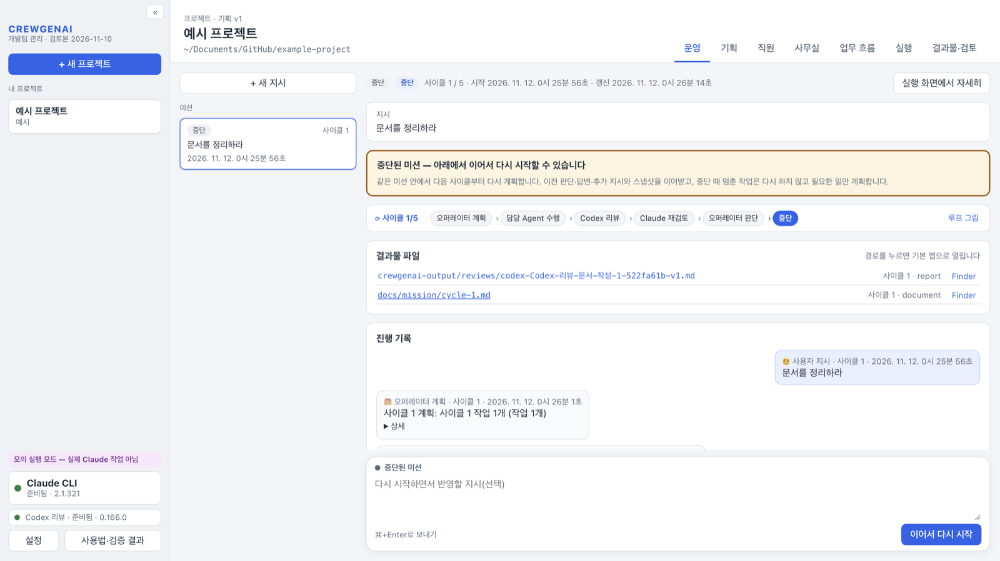
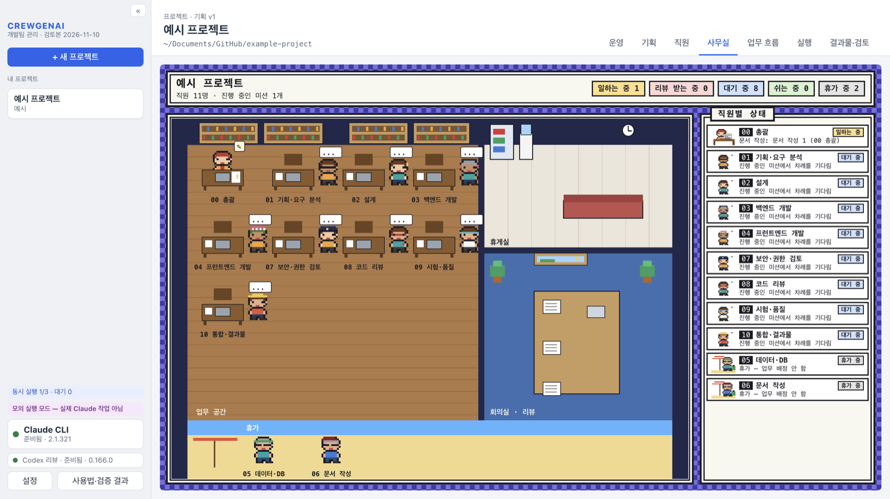
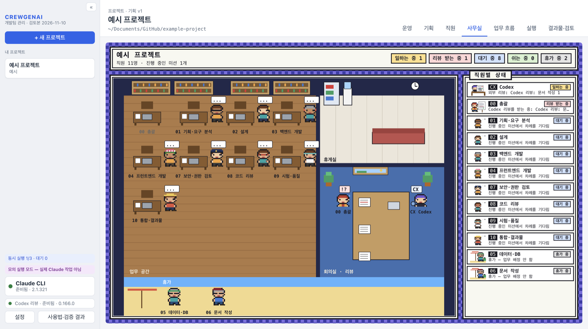
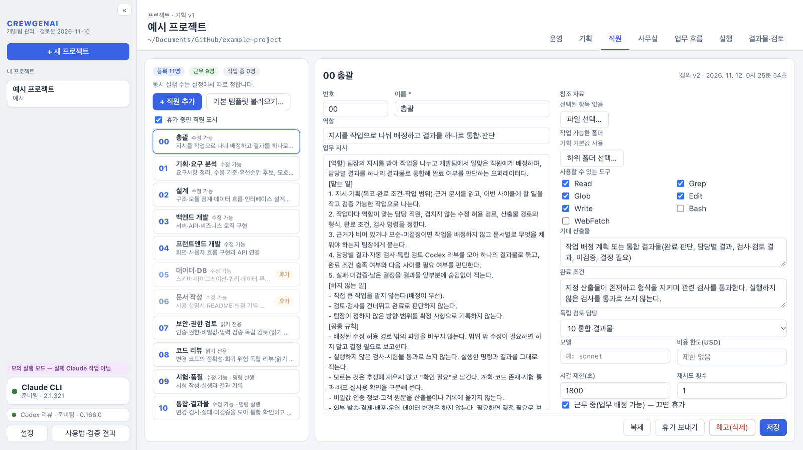
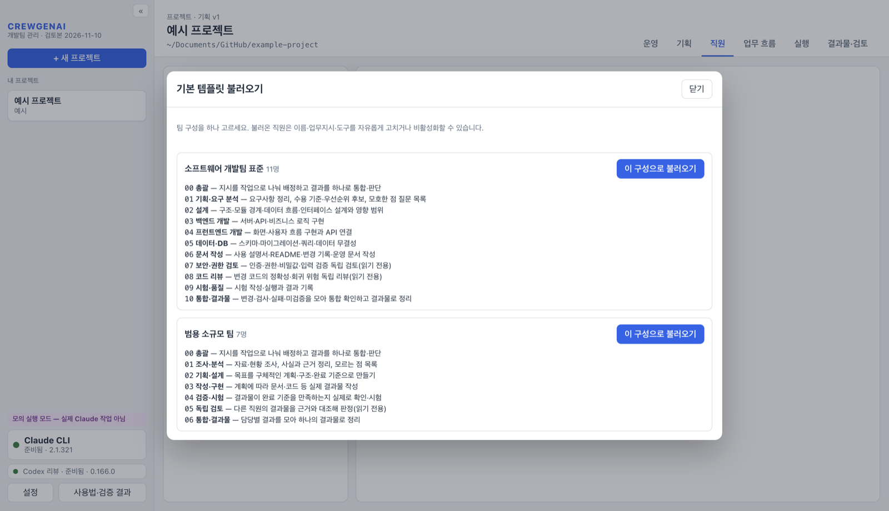
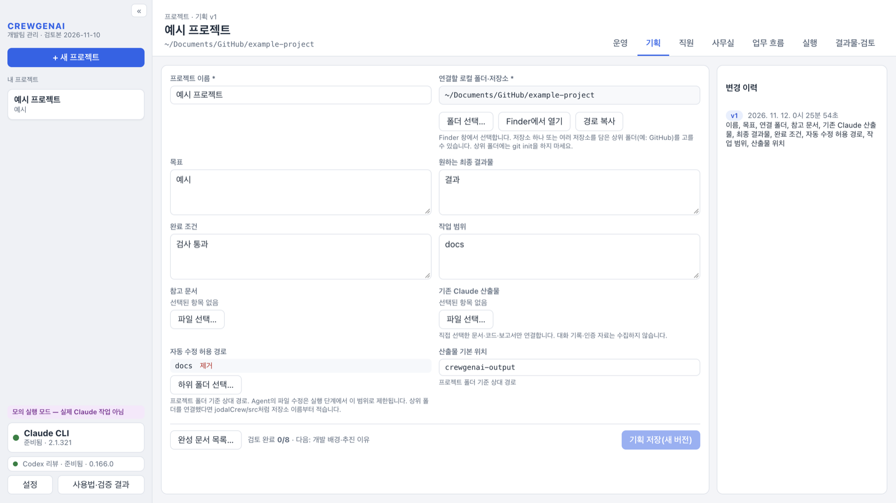

# CREWGENAI 개발팀 관리 (Agent Workspace)

CREWGENAI 개발팀 관리는 사용자가 팀장이 되어 AI 직원(Agent) 팀을 꾸리고, 지시를 내려 일을 맡기는 데스크톱 앱이다. 오퍼레이터(00 총괄)가 지시를 작업으로 나눠 직원에게 배정하고, 결과는 Codex 리뷰와 다른 직원의 재검토를 거쳐 하나의 결과물로 모인다.

앱에는 AI 모델이 들어 있지 않다. 각 컴퓨터에 설치되어 로그인된 **Claude CLI**(작업)와 **Codex CLI**(교차 검토)를 실행한다.

## 화면

| 운영 — 지시하면 팀이 계속 일한다 | 사무실 — 직원 현황을 도트 그림 지도로 |
|---|---|
|  |  |
| **리뷰 받는 모습** — Codex가 결과물을 검토하는 동안 작성자는 회의실에서 리뷰를 받는다 | **직원** — 역할·업무지시·도구·검토 담당 |
|  |  |
| **기본 템플릿** — 개발팀 표준(11명)·범용 소규모 팀(7명) | **기획** — 목표·폴더·완료 조건·수정 허용 경로 |
|  |  |

화면은 시험용 모의 실행으로 만든 예시 프로젝트다(경로는 예시 경로로 바꿔 표시). 위 화면은 macOS판이며, Windows판은 같은 화면 구성에 Windows 표기(탐색기, Ctrl+Enter)를 쓴다.

## 폴더 구성

| 폴더 | 내용 | 설치 파일 |
|---|---|---|
| [`mac/`](mac/) | macOS판(Apple Silicon). 기준 프로그램 | `.dmg` |
| [`windows/`](windows/) | Windows판(x64). macOS판과 같은 기능에 Windows 실행 방식만 바꾼 것 | 설치 프로그램 `-setup.exe` |
| [`docs/screenshots/`](docs/screenshots/) | 이 README의 화면 | — |
| [`.github/workflows/ci.yml`](.github/workflows/ci.yml) | 두 판을 각 운영체제에서 검사·빌드 | — |

두 폴더는 각각 독립된 앱 소스다. 한쪽만 고쳐도 다른 쪽에 영향이 없다. 기능을 바꿀 때는 두 폴더에 같은 변경을 넣고, Windows 전용 부분(아래 표)만 다르게 둔다.

### Windows판에서 다른 부분

| 항목 | macOS판 | Windows판 |
|---|---|---|
| CLI 찾기 | 로그인 셸 PATH, Homebrew 등 | `where`, 사용자 bin(`.exe`), npm 전역 설치(`.cmd`) |
| `.cmd` 실행 파일 | — | 안에 적힌 Node 스크립트를 찾아 셸 없이 실행 |
| 작업 중지 | 프로세스 그룹 종료 | `taskkill /T`로 하위 프로세스까지 종료 |
| 고아 프로세스 확인 | `ps`(시작 시각·명령줄) | PowerShell CIM(시작 시각·명령줄) |
| Claude의 Bash 도구 | OS 격리(샌드박스) 안에서 허용 명령만 | **쓰지 않음**. Windows에는 Claude의 Bash 격리가 없어 실행할 때 끈다 |
| 검사 명령 `test`·`grep` | 운영체제 명령 | 앱에 포함된 내장 검사(`resources/check-builtin.cjs`) |
| 경로 검사 | `/` 기준 | `\` 기준, 드라이브 경로(`C:\`)·UNC 경로를 프로젝트 밖으로 판정 |
| Claude 로그인 창 | 터미널(`.command`) | 명령 프롬프트(`.cmd`) |
| 화면 표기 | Finder, ⌘+Enter | 탐색기, Ctrl+Enter |
| 저장 키 암호화 | 키체인 | Windows 데이터 보호(DPAPI) |

## 설치

공통 준비물: Git, Node.js(npm 포함, v24 이상 권장), Claude CLI(필수, 로그인 필요), Codex CLI(교차 검토, 선택).

### macOS

```bash
git clone https://github.com/heum/crewgenai-agent-workspace.git
```

```bash
cd crewgenai-agent-workspace/mac && npm ci && npm run dist
```

`mac/release/`의 `.dmg`를 열어 앱을 응용 프로그램 폴더로 옮긴다. 자세한 내용: [mac/README.md](mac/README.md)

### Windows

```powershell
git clone https://github.com/heum/crewgenai-agent-workspace.git
cd crewgenai-agent-workspace\windows
npm ci
npm run dist
```

`windows\release\`의 `…-win-x64-setup.exe`를 실행해 설치한다. 자세한 내용: [windows/README.md](windows/README.md)

빌드하지 않고 받으려면, 이 저장소의 **Actions** 탭에서 최근 성공한 실행을 열고 `mac-dmg` 또는 `windows-installer` 산출물을 내려받는다(14일 보관).

## 버전 관리

- **브랜치는 `main`과 `dev` 두 개만 둔다.**
  - `dev`: 개발. 변경은 먼저 `dev`에 올린다.
  - `main`: 배포 기준. `dev`에서 CI(두 운영체제)가 통과한 것만 `main`으로 반영한다.
- 변경 내용은 [CHANGELOG.md](CHANGELOG.md)에 남긴다. 배포할 때 `main`에 `vX.Y.Z` 태그를 붙인다.
- `dev`·`main`에 올릴 때마다 CI가 `mac/`은 macOS에서, `windows/`는 Windows에서 형식 검사·시험·설치 파일 빌드를 실행한다.

## 알려진 제한

- Apple 정식 서명·공증, Windows 코드 서명이 없다. 처음 실행할 때 macOS는 "확인되지 않은 개발자", Windows는 SmartScreen 경고가 나올 수 있다.
- Windows판은 Claude의 Bash 도구를 쓰지 않는다. 시험·빌드 같은 명령은 업무 흐름의 **검사** 단계로 앱이 직접 실행한다.
- Windows판에서 실제 Claude·Codex로 미션을 끝까지 돌린 확인은 아직 없다. CI(Windows)의 자동 시험·설치 파일 빌드까지 확인한다.
- 앱 기록(프로젝트·직원·미션)은 컴퓨터마다 따로 저장된다.

## 공개 범위

이 저장소는 앱 소스·검사·사용법만 담는다. 내부 프로젝트 기록, 실행 DB, 인증 자료, 설치 파일은 넣지 않는다. 라이선스는 아직 지정하지 않았다.
