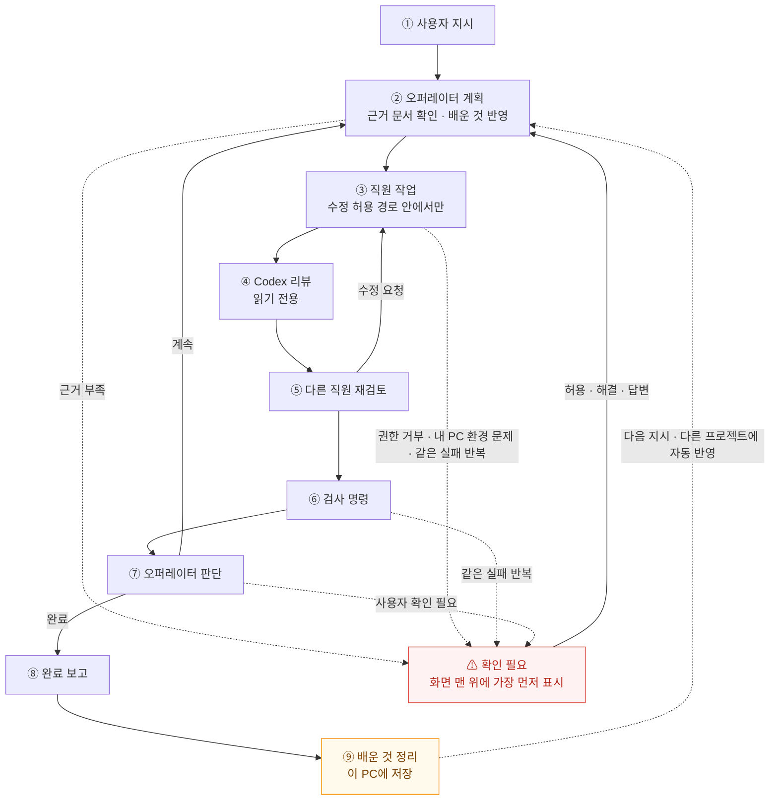
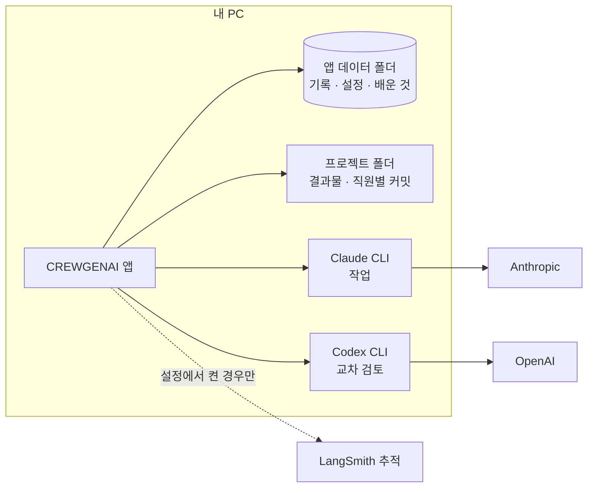
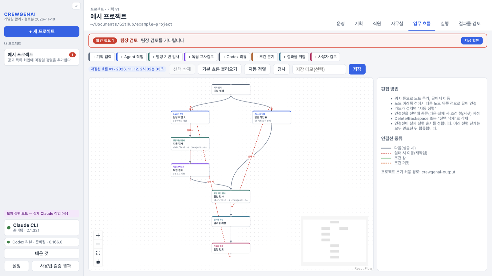
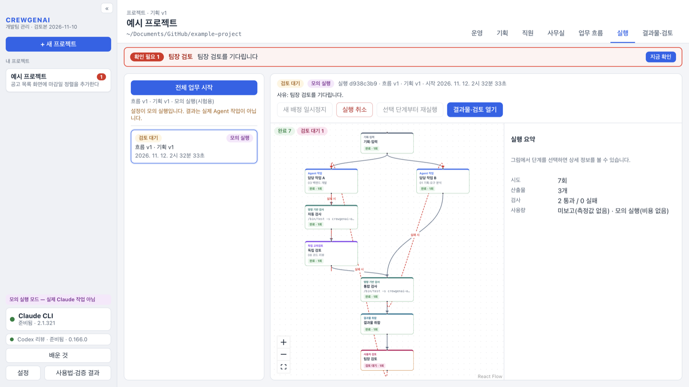
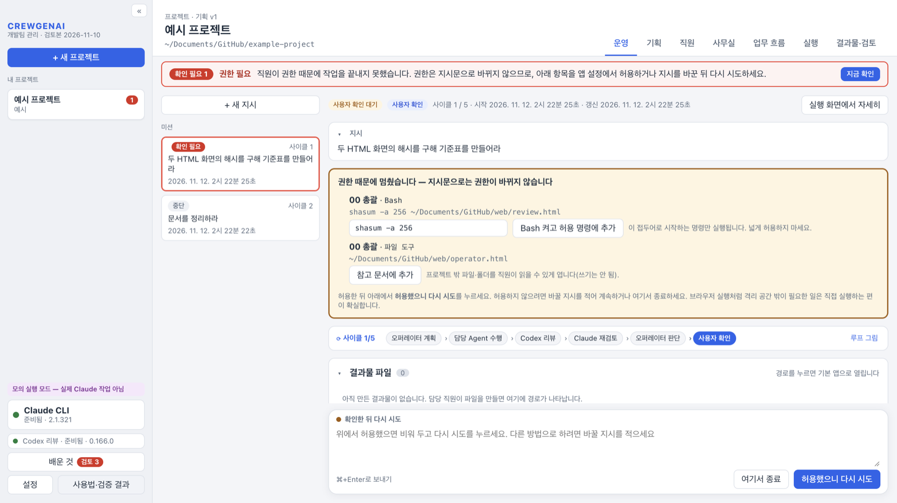
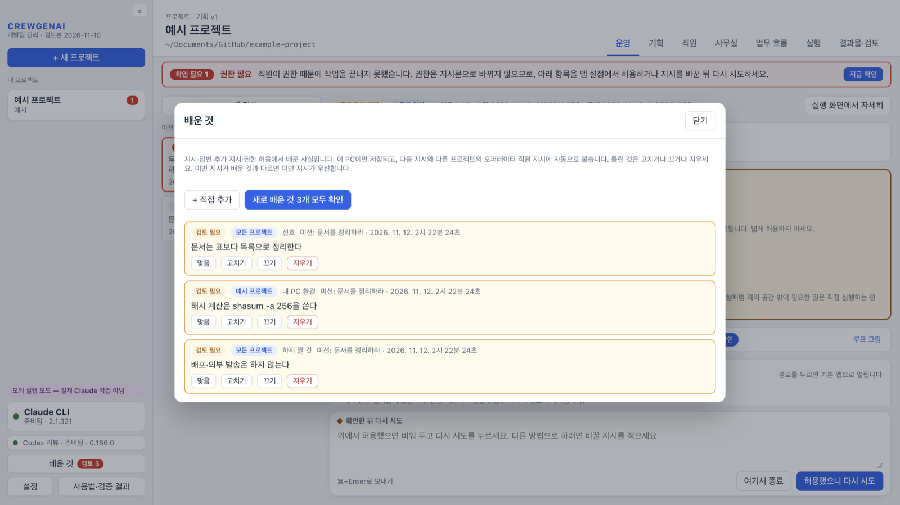

# CREWGENAI 개발팀 관리 (Agent Workspace)

CREWGENAI 개발팀 관리는 사용자가 팀장이 되어 AI 직원(Agent) 팀을 꾸리고, 지시를 내려 일을 맡기는 데스크톱 앱이다. 오퍼레이터(00 총괄)가 지시를 작업으로 나눠 직원에게 배정하고, 결과는 Codex 리뷰와 다른 직원의 재검토를 거쳐 하나의 결과물로 모인다.

앱에는 AI 모델이 들어 있지 않다. 각 컴퓨터에 설치되어 로그인된 **Claude CLI**(작업)와 **Codex CLI**(교차 검토)를 실행한다.

## 작동 흐름

지시 하나가 계획 → 직원 작업 → 리뷰·재검토 → 검사 → 판단을 거쳐 결과물이 된다. 에이전트가 스스로 풀 수 없는 일은 같은 설정으로 다시 돌지 않고 **확인 필요**로 멈춰 사용자에게 먼저 보인다. 미션이 끝나면 대화에서 배운 것을 정리해 다음 지시에 반영한다.



### 데이터가 머무는 곳



앱이 직접 밖으로 보내는 것은 LangSmith 추적(기본 꺼짐)뿐이다. 작업 내용은 사용자가 로그인한 CLI가 각 서비스로 보낸다. 자세한 내용: [SECURITY.md](SECURITY.md)

## 흐름별 화면

화면은 시험용 모의 실행으로 만든 예시 프로젝트다(경로는 예시 경로로 바꿔 표시). macOS판 화면이며, Windows판은 같은 구성에 Windows 표기(탐색기, Ctrl+Enter)를 쓴다.

### 1. 기획 — 무엇을, 어느 폴더에서, 어디까지

목표·완료 조건·작업 범위와 연결 폴더(저장소 하나 또는 여러 저장소를 담은 상위 폴더), 직원이 고칠 수 있는 경로를 정한다. **완성 문서 목록**의 프롬프트로 근거 문서를 만들어 올린다.


### 2. 직원 — 팀 구성

기본 템플릿(소프트웨어 개발팀 표준 11명, 범용 소규모 팀 7명)으로 시작해 역할·업무지시·도구·허용 명령·검토 담당을 정한다. 휴가(비활성)·해고(삭제)할 수 있다.

| 기본 템플릿 불러오기 | 직원 정의 |
|---|---|
|  |  |

### 3. 업무 흐름 — 단계를 이어 그리기

직원 작업·명령 기반 검사·독립 교차검토·Codex 리뷰·조건 분기·결과물 취합·사용자 검토를 카드로 놓고 연결선으로 순서를 정한다. 연결선 종류(다음·실패 시 재작업·조건 참/거짓)가 실제 실행 순서가 된다. 운영 탭의 미션은 오퍼레이터가 이 흐름을 사이클마다 자동으로 짠다.



### 4. 운영 — 지시하면 팀이 계속 일한다 (흐름 ①~⑧)

아래 고정 입력창에 지시한다. 진행 중에는 추가 지시·지금 반영·중단을 쓰고, 지시·결과물 파일·진행 기록·작업 흐름은 접었다 펼 수 있다.


### 5. 실행 — 단계별 진행 상황

흐름이 실행되면 단계마다 상태(완료·검토 대기·재작업·실패)와 시도 횟수가 그림에 표시된다. 단계를 누르면 직원 출력·검사 결과·변경 파일을 보고, 선택 단계부터 다시 실행하거나 결과물·검토로 넘어간다.



### 6. 사무실 — 지금 누가 무엇을 하는지 (흐름 ③~⑤)

직원 상태를 도트 그림 지도로 본다. 코딩·문서 작성은 자기 책상에서, 리뷰는 회의실에서(검토하는 쪽과 리뷰 받는 쪽이 마주 앉음), 쉬는 직원은 휴게실, 휴가는 해변에 있다.

| 작업 중 | 리뷰 받는 중 |
|---|---|
|  |  |

### 7. 확인 필요 — 에이전트가 풀 수 없을 때 (⚠)

권한 거부, 내 PC 환경 문제(명령·프로그램 없음, 접근 거부, 네트워크·로그인), 같은 실패 반복은 다시 돌지 않고 멈춘다. 화면 맨 위 빨간 막대·프로젝트 목록 숫자·미션 목록 맨 위로 가장 먼저 알린다. 권한은 화면에서 바로 허용(허용 명령·참고 문서)한 뒤 다시 시도한다.



### 8. 배운 것 — 다음 지시가 더 잘 맞도록 (흐름 ⑨)

미션을 끝내거나 종료하면 지시·추가 지시·답변·권한 허용에서 배운 선호·환경·규칙·사실을 이 PC에 저장하고 다음 지시와 다른 프로젝트에 자동 반영한다. 새로 배운 것은 **검토 필요**로 맨 위에 보이며, 맞음·고치기·끄기·지우기를 할 수 있다.



## 폴더 구성

| 폴더 | 내용 | 설치 파일 |
|---|---|---|
| [`mac/`](mac/) | macOS판(Apple Silicon). 기준 프로그램 | `.dmg` |
| [`windows/`](windows/) | Windows판(x64). macOS판과 같은 기능에 Windows 실행 방식만 바꾼 것 | 설치 프로그램 `-setup.exe` |
| [`docs/screenshots/`](docs/screenshots/) | 이 README의 화면 | — |
| [`.github/workflows/ci.yml`](.github/workflows/ci.yml) | 두 판을 각 운영체제에서 검사·빌드 | — |

두 폴더는 각각 독립된 앱 소스다. 한쪽만 고쳐도 다른 쪽에 영향이 없다. 기능을 바꿀 때는 두 폴더에 같은 변경을 넣고, Windows 전용 부분(아래 표)만 다르게 둔다.

### Windows판에서 다른 부분

| 항목 | macOS판 | Windows판 |
|---|---|---|
| CLI 찾기 | 로그인 셸 PATH, Homebrew 등 | `where`, 사용자 bin(`.exe`), npm 전역 설치(`.cmd`) |
| `.cmd` 실행 파일 | — | 안에 적힌 Node 스크립트를 찾아 셸 없이 실행 |
| 작업 중지 | 프로세스 그룹 종료 | `taskkill /T`로 하위 프로세스까지 종료 |
| 고아 프로세스 확인 | `ps`(시작 시각·명령줄) | PowerShell CIM(시작 시각·명령줄) |
| Claude의 Bash 도구 | OS 격리(샌드박스) 안에서 허용 명령만 | **쓰지 않음**. Windows에는 Claude의 Bash 격리가 없어 실행할 때 끈다 |
| 검사 명령 `test`·`grep` | 운영체제 명령 | 앱에 포함된 내장 검사(`resources/check-builtin.cjs`) |
| 경로 검사 | `/` 기준 | `\` 기준, 드라이브 경로(`C:\`)·UNC 경로를 프로젝트 밖으로 판정 |
| Claude 로그인 창 | 터미널(`.command`) | 명령 프롬프트(`.cmd`) |
| 화면 표기 | Finder, ⌘+Enter | 탐색기, Ctrl+Enter |
| 저장 키 암호화 | 키체인 | Windows 데이터 보호(DPAPI) |

## 설치

공통 준비물: Git, Node.js(npm 포함, v24 이상 권장), Claude CLI(필수, 로그인 필요), Codex CLI(교차 검토, 선택).

### macOS

```bash
git clone https://github.com/heum/crewgenai-agent-workspace.git
```

```bash
cd crewgenai-agent-workspace/mac && npm ci && npm run dist
```

`mac/release/`의 `.dmg`를 열어 앱을 응용 프로그램 폴더로 옮긴다. 자세한 내용: [mac/README.md](mac/README.md)

### Windows

```powershell
git clone https://github.com/heum/crewgenai-agent-workspace.git
cd crewgenai-agent-workspace\windows
npm ci
npm run dist
```

`windows\release\`의 `…-win-x64-setup.exe`를 실행해 설치한다. 자세한 내용: [windows/README.md](windows/README.md)

빌드하지 않고 받으려면, 이 저장소의 **Actions** 탭에서 최근 성공한 실행을 열고 `mac-dmg` 또는 `windows-installer` 산출물을 내려받는다(14일 보관).

## 내 기록은 내 PC에

앱의 기록(프로젝트, 직원, 미션, 실행·검토 기록, 설정, 배운 것)은 저장소가 아니라 각 사용자 PC의 앱 데이터 폴더에 저장된다. 같은 PC에서는 앱을 껐다 켜도, 새 판으로 업데이트해도 그대로 이어서 쓴다.

| 운영체제 | 앱 데이터 폴더 |
|---|---|
| macOS | `~/Library/Application Support/CREWGENAI 개발팀 관리/` |
| Windows | `%APPDATA%\CREWGENAI 개발팀 관리\` |

- 앱 메뉴 **파일 → 데이터 폴더 보기**로 열 수 있다.
- **업데이트**(`git pull` 후 다시 빌드해 덮어 설치)해도 기록은 유지된다. 새 판은 저장 형식에 항목을 더하기만 하고 기존 기록을 지우지 않는다.
- **삭제**: macOS에서 앱을 휴지통으로 옮기거나, Windows에서 프로그램을 제거해도 앱 데이터 폴더는 남는다. 기록까지 지우려면 이 폴더를 직접 지운다.
- **백업·다른 PC로 옮기기**: 앱을 끈 뒤 이 폴더를 통째로 복사한다. 기록 안의 프로젝트 폴더 경로는 원래 PC 기준이라, 다른 PC에서는 기획 탭에서 폴더를 다시 골라야 할 수 있다.
- 기록은 이 저장소에 올라가지 않는다. 앱이 밖으로 보내는 데이터는 [SECURITY.md](SECURITY.md)에 정리했다.

## 버전 관리

- **브랜치는 `main`과 `dev` 두 개만 둔다.**
  - `dev`: 개발. 변경은 먼저 `dev`에 올린다.
  - `main`: 배포 기준. `dev`에서 CI(두 운영체제)가 통과한 것만 `main`으로 반영한다.
- 변경 내용은 [CHANGELOG.md](CHANGELOG.md)에 남긴다. 배포할 때 `main`에 `vX.Y.Z` 태그를 붙인다.
- `dev`·`main`에 올릴 때마다 CI가 `mac/`은 macOS에서, `windows/`는 Windows에서 형식 검사·시험·설치 파일 빌드를 실행한다.

## 알려진 제한

- Apple 정식 서명·공증, Windows 코드 서명이 없다. 처음 실행할 때 macOS는 "확인되지 않은 개발자", Windows는 SmartScreen 경고가 나올 수 있다.
- Windows판은 Claude의 Bash 도구를 쓰지 않는다. 시험·빌드 같은 명령은 업무 흐름의 **검사** 단계로 앱이 직접 실행한다.
- Windows판에서 실제 Claude·Codex로 미션을 끝까지 돌린 확인은 아직 없다. CI(Windows)의 자동 시험·설치 파일 빌드까지 확인한다.
- 앱 기록(프로젝트·직원·미션)은 컴퓨터마다 따로 저장된다.

## 공개 범위

보안 정책과 취약점 신고 방법: [SECURITY.md](SECURITY.md)

이 저장소는 앱 소스·검사·사용법만 담는다. 내부 프로젝트 기록, 실행 DB, 인증 자료, 설치 파일은 넣지 않는다. 라이선스는 아직 지정하지 않았다.
